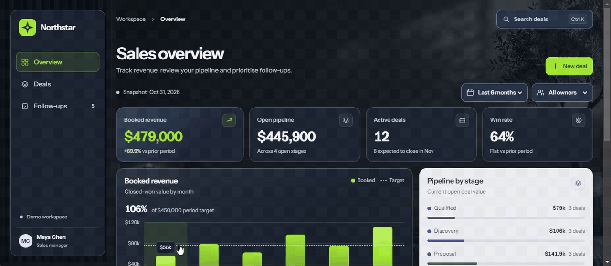

# Northstar CRM

Northstar is an interactive, fictional sales workspace designed for weekly pipeline reviews.

## Demo

[Open the interactive dashboard](https://northstar-crm-demo.sturdyladle.chatgpt.site/)

## Explore

- Change the reporting period or owner to update the overview.
- Explore booked revenue and pipeline stages, and drill into deals.
- Search, filter, edit, and export deals, and manage follow-ups.

## About the demo

The demo uses a fixed 31 October 2026 snapshot. All companies, people, and amounts are fictional. Changes persist in the current browser, and the dashboard has no live CRM connection.
